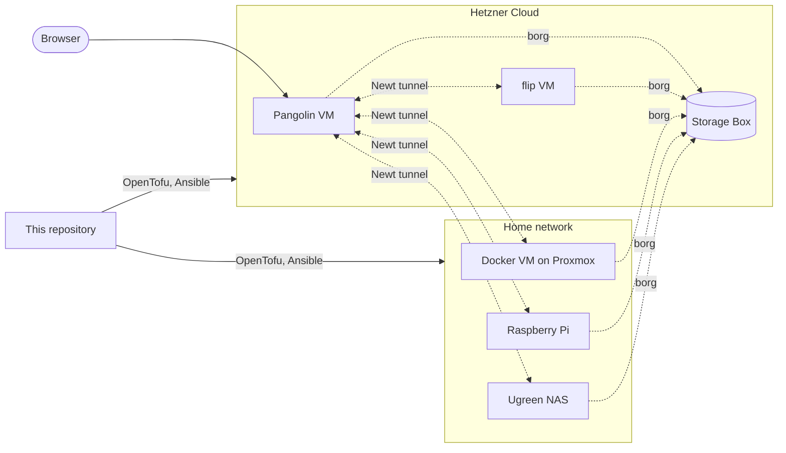

# Homelab

This repository holds the code for my self-hosted setup. OpenTofu creates the machines and the Pangolin configuration, Ansible configures the hosts and deploys each app with Docker Compose, SOPS with Age keeps the secrets, and Borgmatic backs everything up to a Hetzner Storage Box.

Every public app goes through Pangolin, a reverse proxy and tunnel server on a Hetzner VM. Each host runs a Newt client that keeps a tunnel open to Pangolin, so nothing at home and nothing on `flip` needs an inbound port. The apps run on four hosts: a Docker VM on Proxmox at home, a Raspberry Pi for Immich, the Ugreen NAS for Jellyfin (private, reached at home or through the Pangolin client), and `flip`, a Hetzner VM with no public IP that reaches the Internet through Pangolin.



## Quick start

You need:

- [mise](https://mise.jdx.dev/), which installs the pinned tools (OpenTofu, SOPS, Age, uv, Python);
- an Age private key listed in `.sops.yaml`, at the path set in `.sopsrc`, to decrypt `secrets.sops.yaml`;
- read access to the S3 bucket that stores the OpenTofu state. Its credentials are in `secrets.sops.yaml`, and mise loads that file into the environment of every task.

```bash
mise install
uv sync
mise run init && mise run plan    # tofu/pangolin
cd ansible
ansible-playbook pangolin.yaml --check --diff    # dry run (inventory from ansible.cfg)
```

Apply `tofu/pangolin` first, because `tofu/pangolin_config` and `tofu/dns` read its state. Then apply `tofu/pangolin_config` before running the Ansible playbooks: they read its outputs (healthcheck URLs, Newt credentials). The Ansible inventory is built from the OpenTofu state, so a new host only shows up after its `tofu apply`.

[AGENTS.md](AGENTS.md) is the index of the rest: every mise task, the rules not to break, and where each topic is documented (`docs/conventions/`, a `README.md` per role or Tofu module).

## Hosted apps

[docs/apps.md](docs/apps.md) lists the apps, the host each one runs on and its address.

## Backup and restore

Each app has its own Borg repository on the Storage Box, filled by a nightly Borgmatic run. [docs/backup-restore.md](docs/backup-restore.md) shows how to restore one.

## Links

- [Read-only access to the Docker socket](https://www.it-connect.fr/docker-comment-ameliorer-la-securite-avec-un-docker-socket-proxy/) (in French). Newt reads Docker only through its `wollomatic/socket-proxy` sidecar (container list, inspect of itself, events), and it must share a Docker network with the containers it serves.
- [Pangolin discussion #402](https://github.com/orgs/fosrl/discussions/402#discussion-8123152)
- [Pangolin blueprints](https://pangolin.net/blog/posts/blueprints)
