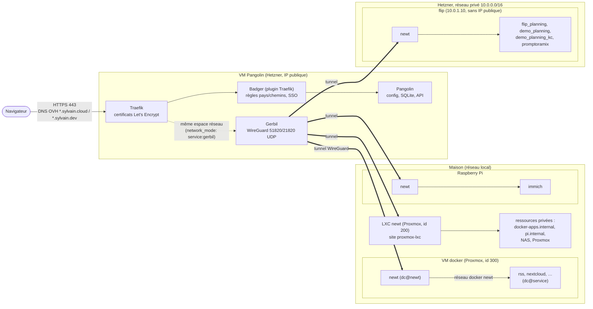
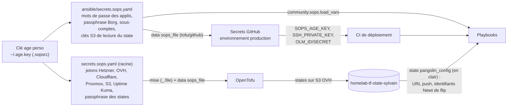

# Architecture du homelab

La carte à garder en tête quand quelque chose casse. Le détail des conventions
est dans [AGENTS.md](../AGENTS.md) ; les procédures d'incident dans
[runbooks/](runbooks/README.md).

## Le chemin d'une requête

1. Le DNS (`tofu/dns`, chez OVH) envoie tous les sous-domaines vers l'IP
   publique de Pangolin.
2. **Traefik** termine le TLS (certificats Let's Encrypt dans
   `/opt/pangolin/config/letsencrypt`) puis passe la requête à **Badger**, le
   middleware de Pangolin, qui applique les règles de la ressource : chemins
   publics (priorités 1 à 9), pays FR et DE autorisés (10, 11), pays de voyage
   (20), tout le reste refusé (99). Ensuite seulement vient le SSO.
3. **Gerbil** porte les tunnels WireGuard. Chaque hôte fait tourner un
   **Newt** qui ouvre un tunnel *sortant* vers Pangolin : aucun port entrant
   n'est ouvert à la maison ni sur flip.
4. Newt joint le conteneur par son nom sur le réseau Docker `newt`. Un
   conteneur qui n'est pas sur ce réseau est injoignable, même s'il tourne.
5. Si toutes les cibles d'une ressource sont en échec de healthcheck, Pangolin
   sert sa **page de maintenance** (réponse 200). Le moniteur Uptime Kuma
   cherche le titre de cette page (mot-clé inversé) : le trouver = DOWN
   (`tofu/pangolin_config/maintenance.tf`).

Tout ce routage (ressources, cibles, règles, rôles SSO, moniteurs Uptime
Kuma) est déclaré dans `tofu/pangolin_config/`, une entrée de
`local.websites` par appli (`website_<app>.tf`). Aucun label Docker.

## Où tourne quoi

| Hôte | Où | Créé par | Configuré par | Ce qui tourne |
|---|---|---|---|---|
| `pangolin` | Hetzner Cloud (nbg1), IP publique | `tofu/pangolin` | `ansible/pangolin.yaml` | pile Pangolin (`pangolin.service`, unité **système**, root), NAT du réseau privé (`nat-gateway.service`), ufw + fail2ban |
| `flip` | Hetzner Cloud (fsn1), **sans IP publique** | `tofu/pangolin/flip.tf` | `ansible/flip.yml` | Flip Planning (prod, démo, démo Keycloak), Promptoramix |
| `docker` | VM Proxmox 300 (3 cœurs, 12 Gio, disque **rotatif**) | `tofu/proxmox` | `ansible/docker.yml` | toutes les autres applis |
| `pi` | Raspberry Pi, réseau local | à la main | `ansible/pi.yml` | Immich |
| LXC newt | conteneur Proxmox 200 | `tofu/proxmox` | `ansible/lxc.yml` (rôles `security` et `newt_service`, identifiants lus dans l'état `pangolin_config`) | le Newt du site `proxmox-lxc` : ressources privées du réseau local |
| Storage Box | Hetzner | `tofu/pangolin` | `ansible/backup.yaml` | dépôts Borg |

Sur les hôtes à applis (`docker`, `pi`, `flip`), chaque appli est un projet
Compose dans `/opt/apps/<service>`, lancé par l'unité systemd **utilisateur**
`dc@<service>` de `sylvain` (modèle `ansible/roles/docker_service`). Newt
lui-même est `dc@newt`.

**flip** n'a pas d'IP publique :

- il sort sur Internet par Pangolin : route `0.0.0.0/0` du réseau privé vers
  Pangolin (`hcloud_network_route.nat`, `tofu/pangolin/nat.tf`), MASQUERADE
  posé par `nat-gateway.service` (rôle `nat_gateway`), route par défaut et DNS
  maintenus côté flip par `nat-client-watchdog` (rôle `nat_client`) ;
- on s'y connecte en SSH par rebond sur Pangolin (`mise run ssh_flip` dans
  `ansible/`, ProxyCommand généré par `ansible/inventory/hetzner.py`) ;
- `flip.internal` (ressource privée Pangolin) passe par le Newt de flip
  lui-même : jamais pour Ansible, une play qui relance newt couperait sa
  propre connexion.

## D'où vient chaque secret

- **Destinataires age** (`.sops.yaml`) : `perso`, `pro` et `secours` pour les
  deux fichiers ; `github-actions` pour `ansible/secrets.sops.yaml` seulement
  (la CI n'a pas les jetons cloud).
- **States OpenTofu** : tous dans le bucket S3 `homelab-tf-state-sylvain`
  (OVH, `s3.eu-west-par.io.cloud.ovh.net`). Ceux de `pangolin`, `github` et
  `s3_state` sont **chiffrés** (`encryption.tf`, AES-GCM, passphrase
  `TF_VAR_state_encryption_passphrase` du SOPS racine, sans repli en clair).
  Celui de `pangolin_config` reste en clair parce qu'Ansible le lit : un
  utilisateur S3 dédié (`tofu/s3_state/user_ansible.tf`) n'a le droit que de
  lire cet objet.
- **Ordre d'application** : `tofu/pangolin` d'abord (`pangolin_config` et
  `dns` lisent son state), puis `tofu/pangolin_config`, puis les playbooks.

## Ce que déploie la CI, et quand

| Workflow | Quand | Ce qu'il fait |
|---|---|---|
| `lint.yaml` | chaque PR | jobs `Ansible lint` (+ `check_sops_shadowing.py`), `OpenTofu lint`, `CI lint` (zizmor, actionlint, hadolint) |
| `test.yaml` | chaque PR | un job par scénario Molecule et par module Tofu testé, récapitulés dans `Tests` |
| `path-bypass-review.yaml` | PR qui touche `path_bypass_images.json` | attend l'approbation de l'environnement `relecture-chemins-publics` |
| `deploy-docker-app.yaml` | **push sur `main`** touchant `ansible/roles/**` ou un playbook d'hôte ; ou à la main | déduit les tags des rôles modifiés (`resolve_docker_tags.py`), monte le tunnel OLM, lance le(s) playbook(s) sur les vrais hôtes |
| `ping.yaml` | à la main | teste le tunnel OLM de la CI |

- **Merger = déployer.** Le ruleset `main` (`tofu/github/ruleset_homelab.tf`)
  exige une PR et les checks `Ansible lint`, `OpenTofu lint`, `Tests` et
  `CI lint` ; le rôle admin peut contourner (correctif urgent).
- Les secrets du déploiement sont dans l'environnement GitHub `production`,
  lisible depuis `main` seulement (`tofu/github/environments.tf`).
- La CI ne lance **jamais** `tofu apply` : l'infra et le routage Pangolin
  s'appliquent à la main.
- Renovate : épingle les images par digest ; seules les versions de
  `planning-equipes` et de `promptoramix` fusionnent seules
  (`renovate.json`) ; les montées majeures de bases attendent une case cochée
  sur le Dependency Dashboard.

## Les sauvegardes

- **Un dépôt Borg par appli**, chiffré (`repokey-blake2`, passphrase
  `backup_passphrase`), dans le dossier de son hôte : `backup/<hôte>/<app>`.
- **Un sous-compte Storage Box par hôte** (`tofu/pangolin/storage_box_subaccounts.tf`) :
  root compromis sur un hôte ne voit pas les dépôts des autres. La clé de root
  est générée sur l'hôte (rôle `borgmatic`) et autorisée chez son sous-compte
  par `ansible/backup.yaml`.
- **Snapshots** de la Storage Box (`tofu/pangolin/storage_box.tf`) : 9
  automatiques, qu'aucun sous-compte ne peut effacer. C'est le filet si un
  hôte compromis efface ses dépôts.
- Rétention Borg : 7 quotidiennes, 4 hebdomadaires, 6 mensuelles, 1 annuelle.
- Un modèle unique, `ansible/roles/borgmatic/templates/app.yaml.j2`, appelé
  par chaque rôle via `include_role: borgmatic tasks_from=app.yml`.
- Restauration : [runbooks/sauvegarde-et-restauration.md](runbooks/sauvegarde-et-restauration.md)
  et [backup-restore.md](backup-restore.md).
