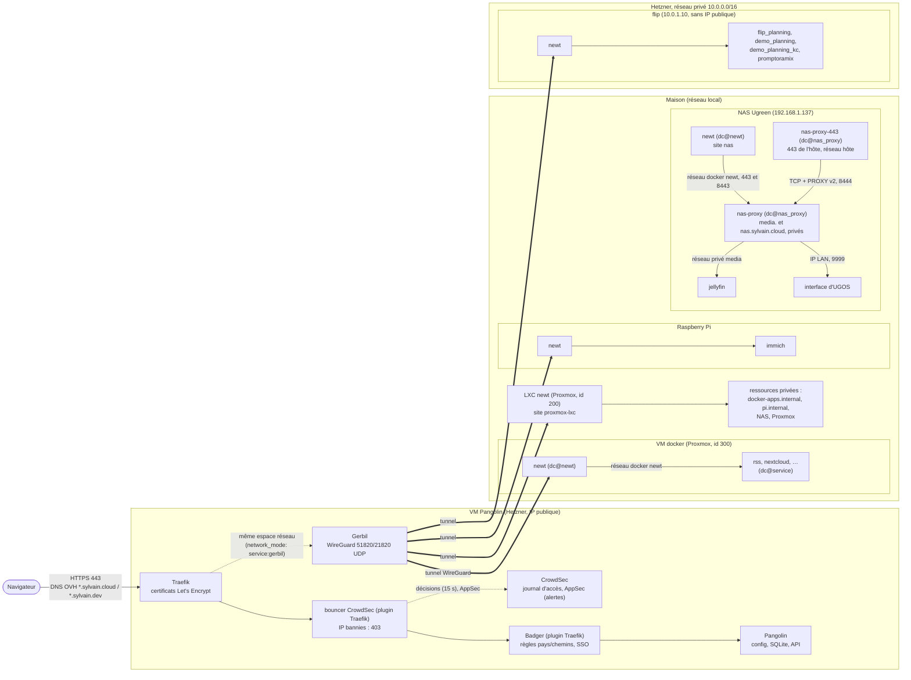
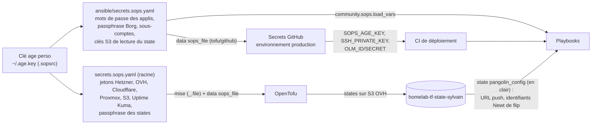
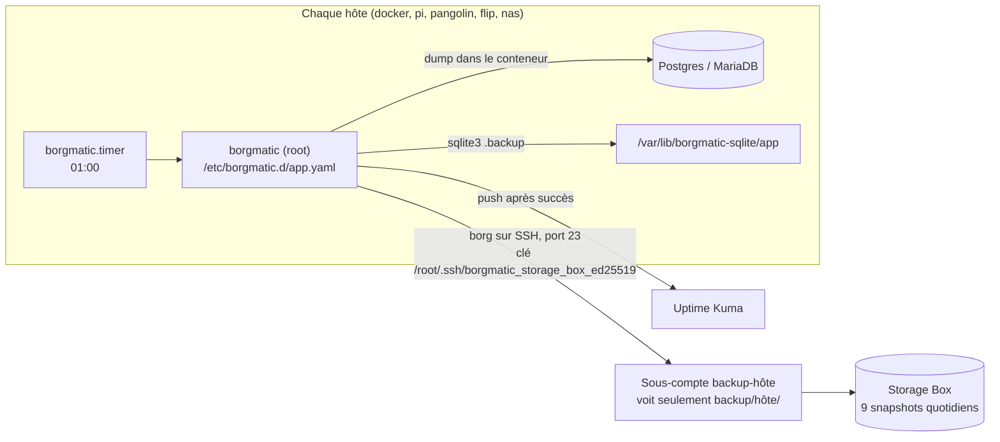
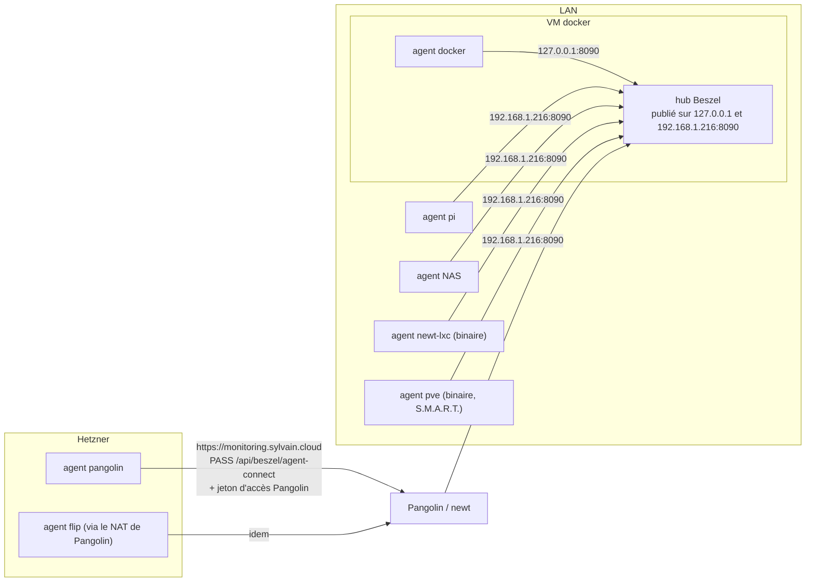

# Architecture du homelab

La carte à garder en tête quand quelque chose casse. Le détail des conventions
est dans [AGENTS.md](../AGENTS.md) ; les procédures d'incident dans
[runbooks/](runbooks/README.md) ; le pourquoi des choix structurants dans
[adr/](adr/README.md).

## Le chemin d'une requête

1. Le DNS (`tofu/dns`, chez OVH) envoie tous les sous-domaines vers l'IP
   publique de Pangolin.
2. **Traefik** termine le TLS (certificats Let's Encrypt dans
   `/opt/pangolin/config/letsencrypt`). Le **bouncer CrowdSec** répond 403 aux
   IP bannies (scénarios sur le journal d'accès, liste communautaire ;
   jamais la maison : [runbooks/crowdsec.md](runbooks/crowdsec.md)), puis
   Traefik passe la requête à **Badger**, le
   middleware de Pangolin, qui applique les règles de la ressource : chemins
   publics (priorités 1 à 9), pays FR et DE autorisés (10, 11), pays de voyage
   (20), tout le reste refusé (99). Ensuite seulement vient le SSO. Ce qui
   passe sans lui (applis mobiles, flux, liens de partage, MCP), appli par
   appli : [acces-mobile.md](acces-mobile.md).
3. **Gerbil** porte les tunnels WireGuard. Chaque hôte fait tourner un
   **Newt** qui ouvre un tunnel *sortant* vers Pangolin : aucun port entrant
   n'est ouvert à la maison ni sur flip.
4. Newt joint le conteneur par son nom sur le réseau Docker `newt`. Un
   conteneur qui n'est pas sur ce réseau est injoignable, même s'il tourne.
5. Si toutes les cibles d'une ressource sont en échec de healthcheck, Pangolin
   sert sa **page de maintenance** (réponse 200). Le moniteur Uptime Kuma
   cherche le titre de cette page (mot-clé inversé) : le trouver = DOWN
   (`tofu/pangolin_config/maintenance.tf`).

Tout ce routage (ressources, cibles, règles, rôles SSO, moniteurs Uptime
Kuma) est déclaré dans `tofu/pangolin_config/`, une entrée de
`local.websites` par appli (`website_<app>.tf`). Aucun label Docker.

Une exception, Jellyfin sur le NAS, qui n'est pas public : une seule adresse,
`https://media.sylvain.cloud`, sans rien exposer sur Internet. Le A public
`media.sylvain.cloud` (`tofu/dns/media.tf`) vise l'IP **LAN** du NAS et prime
sur le joker `*.sylvain.cloud`. Un Traefik propre au NAS (`nas-proxy`, rôle
`nas_proxy`, unité `dc@nas_proxy`) termine le TLS avec un certificat Let's
Encrypt obtenu par DNS-01 OVH, puis passe à Jellyfin. Il sert de même
l'interface d'UGOS : `https://nas.sylvain.cloud` (A public vers l'IP LAN
du NAS, `tofu/dns/nas.tf`), à la maison comme avec le client Pangolin
(ressource privée `nas.sylvain.cloud` du site `proxmox-lxc`, qui vise l'IP LAN
du NAS en TCP 443, 445, 8443 et 9999). Secours : `http://192.168.1.137:9999`.
L'Uptime Kuma de PikaPods ne joint pas ces deux noms : le NAS vérifie
lui-même chaque matin l'échéance de leurs certificats
(`nas-proxy-cert-check.timer`) et pousse le résultat au moniteur
« Certificats NAS », rouge sous 14 jours restants ou sans nouvelles depuis
deux jours.

- En LAN : `https://media.sylvain.cloud`, sans port, ou en `:8443`. Repli :
  `http://192.168.1.137:8096`.
- Dehors, avec le client Pangolin (rôle `jellyfin`) : les mêmes adresses. La
  ressource privée du même nom (alias) vise Traefik sur le réseau `newt`, en
  TCP 443 et 8443 : une appli réglée à la maison n'a pas à changer d'adresse.

Deux ports, parce que le 443 du NAS n'est à nous que tant que l'interface
d'UGOS ne le reprend pas. Le 8443 est publié par Docker sur `nas-proxy` et ne
dépend de rien d'autre. Le 443 de l'hôte n'est libre que si la redirection
HTTPS de l'interface d'UGOS est décochée (sinon son nginx y répond par un 307
vers `:9443`) ; il est tenu par un relais, `nas-proxy-443`, second service du
même compose : un Traefik en réseau hôte qui passe chaque connexion TCP telle
quelle à `nas-proxy` (entrée non publiée `8444`, en PROXY protocol v2 pour
garder l'IP du client). Si une mise à jour d'UGOS recoche la redirection,
nginx prend le 443 au boot, le relais sort et Docker le relance chaque minute,
mais `nas-proxy` et le 8443 tournent : un 443 publié par Docker sur
`nas-proxy` aurait au contraire empêché tout le conteneur de démarrer. Le
déploiement (`--tags nas_proxy`) échoue alors en le disant. Rien ne garantit
pourtant que nginx démarre avant Docker : si le relais tient déjà le 443
quand nginx (re)démarre avec la case recochée, c'est nginx qui échoue, et
toute l'interface d'UGOS avec lui ; secours en SSH : `docker stop
nas-proxy-443`, redémarrer nginx, décocher la case, `docker start
nas-proxy-443`. Le port 80 reste au nginx d'UGOS (le DNS-01 n'en a pas
besoin).

Le mode d'emploi (applis, cast, dépôt et nommage des fichiers, causes de
transcodage, commande ffmpeg de la version 1080p) est dans [media.md](media.md).

## Où tourne quoi

| Hôte | Où | Créé par | Configuré par | Ce qui tourne |
|---|---|---|---|---|
| `pangolin` | Hetzner Cloud (nbg1), IP publique | `tofu/pangolin` | `ansible/pangolin.yaml` | pile Pangolin (`pangolin.service`, unité **système**, root), NAT du réseau privé (`nat-gateway.service`), ufw + fail2ban, CrowdSec (HTTPS) |
| `flip` | Hetzner Cloud (fsn1), **sans IP publique** | `tofu/pangolin/flip.tf` | `ansible/flip.yml` | Flip Planning (prod, démo, démo Keycloak), Promptoramix |
| `docker` | VM Proxmox 300 (3 cœurs, 12 Gio, sur le SSD M.2 SATA de l'hôte) | `tofu/proxmox` | `ansible/docker.yml` | toutes les autres applis |
| `pi` | Raspberry Pi, réseau local | à la main | `ansible/pi.yml` | Immich, Blocky (DNS, conteneur) |
| LXC newt | conteneur Proxmox 200 | `tofu/proxmox` | `ansible/lxc.yml` (rôles `security`, `newt_service` et `blocky`, identifiants lus dans l'état `pangolin_config`) | le Newt du site `proxmox-lxc` : ressources privées du réseau local ; Blocky (DNS, binaire) |
| Storage Box | Hetzner | `tofu/pangolin` | `ansible/backup.yaml` | dépôts Borg |

Sur les hôtes à applis (`docker`, `pi`, `flip`), chaque appli est un projet
Compose dans `/opt/apps/<service>`, lancé par l'unité systemd **utilisateur**
`dc@<service>` de `sylvain` (modèle `ansible/roles/docker_service`). Newt
lui-même est `dc@newt`.

**flip** n'a pas d'IP publique :

- il sort sur Internet par Pangolin : route `0.0.0.0/0` du réseau privé vers
  Pangolin (`hcloud_network_route.nat`, `tofu/pangolin/nat.tf`), MASQUERADE
  posé par `nat-gateway.service` (rôle `nat_gateway`), route par défaut et DNS
  maintenus côté flip par `nat-client-watchdog` (rôle `nat_client`) ;
- on s'y connecte en SSH par rebond sur Pangolin (`mise run ssh_flip` dans
  `ansible/`, ProxyCommand généré par `ansible/inventory/hetzner.py`) ;
- `flip.internal` (ressource privée Pangolin) passe par le Newt de flip
  lui-même : jamais pour Ansible, une play qui relance newt couperait sa
  propre connexion.

## Le DNS de la maison (Blocky)

Le DHCP de la Bbox annonce deux résolveurs Blocky (rôle `blocky`,
[ADR 0012](adr/0012-filtrage-dns-blocky.md)) : le LXC newt (192.168.1.200,
binaire, `lxc.yml`) et le Pi (192.168.1.96, conteneur publié sur son IP LAN
seule, `pi.yml`). Une panne de l'un passe inaperçue des clients, qui
basculent sur l'autre.

- **Amont** : DNS-over-TLS vers Quad9 et Mullvad (`parallel_best`), amorcé par
  leurs IP (`bootstrapDns`) : Blocky ne dépend ni du `resolv.conf` de son hôte
  ni de la Bbox. Cache et préchargement des noms fréquents.
- **Filtrage** : HaGeZi Pro (publicités, traqueurs) et HaGeZi TIF medium
  (domaines malveillants), téléchargées chaque jour, copie gardée sur disque ;
  réponse `0.0.0.0`. Exceptions : `blocky_allowlist`, par PR. Groupes par
  client possibles (`blocky_client_groups`), un seul aujourd'hui.
- **Noms locaux** : le domaine `lan` (noms du DHCP de la Bbox, `pi.lan`,
  `data.lan`…) et la zone inverse du LAN renvoyés à la Bbox ; `pve.lan`,
  `docker.lan`, `nas.lan`, `newt-lxc.lan` déclarés dans le rôle.
- **Rebinding** : une réponse publique qui pointe dans le LAN est vidée, sauf
  `media.sylvain.cloud` et `nas.sylvain.cloud` (A de `tofu/dns` vers le NAS).
- **Aucun journal des requêtes.**
- **Supervision** : Uptime Kuma (PikaPods) ne joint pas le LAN ; chaque hôte
  vérifie son Blocky toutes les 5 minutes (`blocky-check.timer` : un nom qui
  résout, un nom bloqué) et pousse aux moniteurs « DNS Raspberry Pi » et
  « DNS LXC newt » (`tofu/pangolin_config/cron_dns.tf`), alertes par e-mail
  et ntfy.
- **Dehors** : le client Pangolin d'un téléphone peut envoyer son DNS dans le
  tunnel vers 192.168.1.200 (ressource privée `dns`), réglage à faire dans
  l'appli ([runbook](runbooks/dns-blocky.md)).

## D'où vient chaque secret

- **Destinataires age** (`.sops.yaml`) : `perso`, `pro` et `secours` pour les
  deux fichiers ; `github-actions` pour `ansible/secrets.sops.yaml` seulement
  (la CI n'a pas les jetons cloud).
- **States OpenTofu** : tous dans le bucket S3 `homelab-tf-state-sylvain`
  (OVH, `s3.eu-west-par.io.cloud.ovh.net`). Ceux de `pangolin`, `github` et
  `s3_state` sont **chiffrés** (`encryption.tf`, AES-GCM, passphrase
  `TF_VAR_state_encryption_passphrase` du SOPS racine, sans repli en clair).
  Celui de `pangolin_config` reste en clair parce qu'Ansible le lit : un
  utilisateur S3 dédié (`tofu/s3_state/user_ansible.tf`) n'a le droit que de
  lire cet objet.
- **Ordre d'application** : `tofu/pangolin` d'abord (`pangolin_config` et
  `dns` lisent son state), puis `tofu/pangolin_config`, puis les playbooks.

## Ce que déploie la CI, et quand

| Workflow | Quand | Ce qu'il fait |
|---|---|---|
| `lint.yaml` | chaque PR | jobs `Ansible lint` (+ `check_sops_shadowing.py`), `OpenTofu lint`, `CI lint` (zizmor, actionlint, hadolint) |
| `test.yaml` | chaque PR (sélection), chaque nuit et à la main (tout) | un job par scénario Molecule et par module Tofu atteint par la PR (`select_tests.py` ; label `full-tests` : tout), récapitulés dans `Tests` |
| `path-bypass-review.yaml` | PR qui touche `path_bypass_images.json` | attend l'approbation de l'environnement `relecture-chemins-publics` |
| `deploy-docker-app.yaml` | **push sur `main`** touchant `ansible/roles/**` ou un playbook d'hôte ; ou à la main | déduit les tags des rôles modifiés (`resolve_docker_tags.py`), monte le tunnel OLM, lance le(s) playbook(s) sur les vrais hôtes |
| `ping.yaml` | à la main | teste le tunnel OLM de la CI |

- **Merger = déployer.** Le ruleset `main` (`tofu/github/ruleset_homelab.tf`)
  exige une PR et les checks `Ansible lint`, `OpenTofu lint`, `Tests` et
  `CI lint` ; le rôle admin peut contourner (correctif urgent).
- Les secrets du déploiement sont dans l'environnement GitHub `production`,
  lisible depuis `main` seulement (`tofu/github/environments.tf`).
- La CI ne lance **jamais** `tofu apply` : l'infra et le routage Pangolin
  s'appliquent à la main.
- Renovate : épingle les images par digest ; les montées majeures de bases
  attendent une case cochée sur le Dependency Dashboard (la MariaDB officielle
  de Nextcloud n'en voit aucune : elle reste sur la LTS 12.3, et son Redis
  `-bookworm` sur la 8.2). Les digests et les correctifs (hors
  `planning-equipes` et `promptoramix`) arrivent groupés le lundi avant 9 h,
  en deux PR :
  - « weekly stateless automerged updates » **fusionne seule** (auto-merge
    GitHub, une fois les quatre checks du ruleset verts, donc déployée dans la
    foulée) : les images sans base ni migration de données, sur liste
    blanche (`gotenberg`, `tika`, `stirling-pdf`, `homepage`, `nginx`),
    hors du rôle `flip_planning` (le redémarrage emporterait le planning de
    production et sa base), et les correctifs des GitHub Actions
    (`uses:` ; jamais un digest seul, signe d'un tag déplacé) ;
  - « weekly digest and patch updates », tout le reste, à fusionner à la main.

  Fusionnent seules aussi : les versions de `planning-equipes` (mineures et
  correctifs) et de `promptoramix`. Les autres mineures et majeures gardent
  chacune leur PR, à la main. Rien de ce qui touche `path_bypass_images.json`
  ne fusionne seul : sa relecture (`relecture-chemins-publics`) n'est pas un
  check du ruleset, l'auto-merge passerait outre.

## Les sauvegardes

- **Un dépôt Borg par appli**, chiffré (`repokey-blake2`, passphrase
  `backup_passphrase`), dans le dossier de son hôte : `backup/<hôte>/<app>`.
- **Un sous-compte Storage Box par hôte** (`tofu/pangolin/storage_box_subaccounts.tf`) :
  root compromis sur un hôte ne voit pas les dépôts des autres. La clé de root
  est générée sur l'hôte (rôle `borgmatic`) et autorisée chez son sous-compte
  par `ansible/backup.yaml`.
- **Snapshots** de la Storage Box (`tofu/pangolin/storage_box.tf`) : 9
  automatiques, qu'aucun sous-compte ne peut effacer. C'est le filet si un
  hôte compromis efface ses dépôts. Ils disparaîtraient avec la box : elle
  porte `delete_protection` (l'API refuse sa suppression tant que la
  protection n'est pas levée) en plus du `prevent_destroy` de tofu.
- **Pangolin** a en plus les sauvegardes Hetzner de sa VM (`backups = true`,
  7 images quotidiennes) : la reprise rapide, même IP et même clé d'hôte
  ([runbooks/reconstruction-pangolin.md](runbooks/reconstruction-pangolin.md)).
  Elles restent chez Hetzner et partent avec le serveur : Borg reste la copie
  de référence.
- Rétention Borg : 7 quotidiennes, 4 hebdomadaires, 6 mensuelles, 1 annuelle.
- Un modèle unique, `ansible/roles/borgmatic/templates/app.yaml.j2`, appelé
  par chaque rôle via `include_role: borgmatic tasks_from=app.yml`.
- **Le NAS** (Jellyfin : configuration et base SQLite, jamais les médias,
  qui n'ont que les instantanés d'UGOS) : rien ne s'installe sous UGOS,
  borgmatic y tourne dans son image officielle (`borgmatic_install:
  container`, `host_vars/nas`). `borgmatic.timer` (02:30) lance
  `docker compose run --rm` par l'enrobage `/volume1/docker/borgmatic/borgmatic`,
  configurations et clé sous `/volume1/docker/borgmatic`, montées au même
  chemin dans le conteneur ; même modèle, même dépôt par appli, sous-compte
  `backup-nas`.
- **L'hôte Proxmox** sauvegarde en plus la VM docker et le LXC newt entiers
  (job vzdump de `tofu/proxmox/backup.tf`, 21:00, sur le NFS du NAS). Le 2 et
  le 16 du mois, `vzdump-restore-test.timer` (rôle `vzdump_restore_test`,
  `pve.yml`) restaure le LXC sur un id jetable, sans réseau, le démarre puis
  le détruit, et vérifie l'archive entière de la VM ; résultat sur ntfy et au
  moniteur « Test restauration vzdump » :
  [runbooks/test-restauration-vm.md](runbooks/test-restauration-vm.md).
- Restauration : [runbooks/sauvegarde-et-restauration.md](runbooks/sauvegarde-et-restauration.md)
  et [backup-restore.md](backup-restore.md).

## La supervision (Beszel)

Uptime Kuma dit si une appli répond et si ses sauvegardes passent ; Beszel
dit comment vont les hôtes : CPU, mémoire, disques, réseau, conteneurs, et
S.M.A.R.T. là où il y a des disques physiques. Un hub (rôle `beszel`, VM
docker, `monitoring.sylvain.cloud` derrière le SSO puis le compte Beszel) et
un agent par hôte (rôle `beszel_agent`). Les agents ouvrent eux-mêmes une
WebSocket vers le hub : aucun n'écoute de port.

Homepage (`home.sylvain.cloud`) en montre le résumé, groupe Administration :
sur le lien Beszel, le nombre de systèmes et combien sont en ligne ; deux
cartes Uptime Kuma, la page de statut `sylvain-dev` et `homelab-sauvegardes`
(chaque sauvegarde, le restore test, la Storage Box,
`tofu/pangolin_config/status_page_backups.tf`). Homepage les interroge côté
serveur. Le widget Beszel exige un superuser PocketBase : il a le sien
(`beszel_homepage_email`, `host_vars/docker` ; clé sops
`homepage_beszel_password`), que le rôle `beszel` crée par
`beszel superuser upsert`, distinct du compte administrateur. Un superuser lit
et écrit tout le hub : celui qui lit la configuration de Homepage (`0600`, VM
docker) a la main sur Beszel.

- **Hôtes Hetzner** : par la ressource publique, sur le seul chemin
  `/api/beszel/agent-connect`, en PASS (les règles pays sautées : leur IP
  source est privée), avec un jeton d'accès Pangolin par agent
  (`website_beszel.tf`, sortie `beszel_agent_hub_headers`, envoyé en
  `HUB_HEADERS`). Sans jeton, rien n'atteint le hub.
- **Hôtes du LAN** : par le port publié sur la VM docker. Docker publie avant
  ufw, donc **l'interface du hub répond sans SSO à tout le LAN** : le compte
  Beszel (mot de passe `beszel_admin_password`) y est la seule barrière.
- **Authentification d'un agent** : son jeton (`beszel_agent_tokens`, un par
  hôte, déclaré dans le `config.yml` du hub), la clé du hub
  (`beszel_hub_public_key`, le hub signe avec `beszel_hub_private_key`), puis
  son empreinte, que le hub fige à la première connexion. Un hôte reconstruit
  (dossier `data/` de l'agent perdu) est refusé : remettre son empreinte à
  zéro dans le hub (menu du système, jeton et empreinte).
- **`config.yml` fait autorité** : un hôte retiré de `beszel_agent_tokens`
  disparaît du hub avec son historique au redémarrage suivant.
- **Socket Docker** : jamais monté dans l'agent. Un proxy
  (`wollomatic/socket-proxy`, sidecar du compose de l'agent, sans réseau) ne
  laisse passer que les GET dont l'agent a besoin (liste des conteneurs,
  statistiques, version, info, logs d'un conteneur par son identifiant) : ni
  inspect, ni écriture. Newt a le même proxy (rôle `newt`, #853) : liste des
  conteneurs, inspect de lui-même et flux d'événements, rien d'autre. Ce
  socket ne sert qu'à la liste des conteneurs affichée par Pangolin : aucun
  routage n'en dépend.
- **Logs des conteneurs** : la fiche d'un conteneur dans l'interface
  (`CONTAINER_DETAILS=true` côté hub) montre ses 200 dernières lignes,
  demandées à l'agent à chaque ouverture et jamais stockées dans le hub. Tout
  compte Beszel qui voit le système les lit, et sur le LAN ce compte est la
  seule barrière : un token ou un mot de passe qu'une appli écrit dans ses
  logs y devient lisible. L'onglet inspect de la même fiche reste vide : le
  proxy le refuse (403 dans ses logs à chaque ouverture), parce que l'agent
  n'en retire que les variables d'environnement, pas les arguments de
  commande (le `--requirepass` du redis de nextcloud) ni les labels. Sur le
  LXC newt et l'hôte Proxmox (agent binaire, sans Docker), ni fiche de
  conteneur ni logs des services systemd suivis (`SERVICE_PATTERNS`) :
  l'utilisateur éphémère de l'unité (`DynamicUser`) n'est dans aucun groupe
  du journal, l'agent le trouve illisible et coupe ces logs
  (`SupplementaryGroups=systemd-journal` ouvrirait tout le journal).
- **Lancement** : `dc@beszel_agent` (unité user) sur docker, pi et flip ;
  `dc@beszel_agent` en unité système sur le NAS (`nas.yml`, à la main) ;
  `docker compose up -d` et la restart policy sur Pangolin (pas de
  `docker_service`) ; un service systemd sur le LXC newt (`lxc.yml`, à la
  main) et sur l'hôte Proxmox (`pve.yml`, à la main, en root sans become :
  pas de sudo sur l'hôte), qui lit aussi le S.M.A.R.T. de `sda`, le SSD M.2
  SATA qui porte toutes les VM et le LXC (`CAP_SYS_RAWIO`, groupe `disk` et
  `DeviceAllow=/dev/sda r` dans l'unité). L'hôte Proxmox n'a que cet agent et le vérificateur des mises à
  jour (ci-dessous) : ni `00-setup`, ni `security`.
- **Mises à jour** : ni l'hôte Proxmox ni UGOS ne se mettent à jour seuls.
  Le rôle `update_notify` (`pve.yml`, `nas.yml`) publie chaque lundi sur le
  topic `scripts` de ntfy ce qui attend sur Proxmox (sécurité d'abord,
  priorité haute s'il y en a), et chaque mois un rappel avec la version
  d'UGOS installée (UGOS ne dit pas sans session si une mise à jour attend) ;
  moniteurs push « Mises à jour Proxmox » et « Mises à jour NAS » pour un
  vérificateur mort. Procédure :
  [runbooks/mises-a-jour-proxmox-ugos.md](runbooks/mises-a-jour-proxmox-ugos.md).
- **Alertes** : déclarées par le rôle `beszel` (`beszel_alerts`, tag
  `beszel_alerts`) sur tous les systèmes : hôte muet 5 min, CPU et mémoire à
  plus de 90 % sur 10 min, disque à plus de 85 % ; température au-dessus de
  80 °C sur le Pi, le NAS et pve. Le S.M.A.R.T. (WARNING/FAILED) prévient d'office, sans alerte à
  déclarer. `config.yml` ne sait déclarer que les systèmes : alertes et
  canaux vivent dans la base du hub, par utilisateur, et le rôle les pose par
  l'API du hub (`127.0.0.1:8090`, connecté au compte administrateur avec
  `beszel_admin_password`, qui doit donc rester son mot de passe). Elles font
  autorité : une alerte ajoutée dans l'interface est supprimée au déploiement
  suivant. Envoi par Telegram (URL shoutrrr bâtie des clés sops
  `beszel_telegram_bot_token` et `beszel_telegram_chat_id`) et par e-mail
  (SMTP Infomaniak réglé dans l'interface du hub). Test :
  `ansible-playbook docker.yml --tags beszel_alerts_test` (le bouton « Test »
  des réglages, `POST /api/beszel/test-notification`). Si la VM docker tombe,
  Beszel se tait : Uptime Kuma (hors VM) le voit par le moniteur
  `Healthcheck Beszel`.
- **Limites connues** : sur le Pi, la mémoire par conteneur reste vide tant
  que le contrôleur cgroup mémoire est coupé (issue #846) ; son S.M.A.R.T.
  passe par un pont USB RTL9210 (`-d sntrealtek`), non vérifié avant
  déploiement ; le LXC newt (non privilégié) ne voit ni S.M.A.R.T. ni
  capteurs fiables, mais son CPU, sa mémoire, son disque et `newt.service`.
- **Rapport mémoire hebdomadaire** (rôle `mem_report`, docker, pi et flip,
  hors Beszel) : chaque lundi à 09:00, `mem-report.timer` lit le cgroup v2 de
  chaque conteneur (`memory.max`, `memory.peak`, `memory.current`,
  `memory.events`) et publie sur ntfy (topic `scripts`, jeton
  `ntfy_scripts_token`) un message par hôte : à agrandir (pic à 80 % de la
  limite ou plus, ou OOM-kill), à réduire (pic sous 25 %, s'il libère
  64 Mio au moins), sans limite, chacun avec une limite suggérée de 2x le
  pic, arrondie (doctrine des limites, `AGENTS.md`). `memory.peak` et
  `memory.events` repartent de zéro avec le conteneur : un pic mesuré sur
  moins de 7 jours est signalé, et un redémarrage automatique après une
  mise à jour du noyau remet tout l'hôte à zéro. Un OOM-kill du processus
  principal, suivi d'un redémarrage du conteneur, n'apparaît que par
  `redémarré xN` (le nouveau cgroup a perdu le compteur), et un conteneur
  relancé depuis moins de 7 jours n'est jamais proposé à la réduction. À la
  main : `sudo systemctl start mem-report`, le texte complet (lignes coupées
  du message ntfy comprises) dans
  `journalctl -u mem-report`.

## Les journaux (VictoriaLogs)

Beszel montre les 200 dernières lignes d'un conteneur, à la demande ;
VictoriaLogs garde tous les journaux de tous les hôtes **30 jours** et les
interroge en LogsQL. Version légère, à l'essai (#79,
[ADR 0011](adr/0011-journaux-victorialogs.md), « proposée ») : VictoriaLogs
seul, ni Grafana ni métriques. Rôle `victoria_logs` sur la VM docker, interface (vmui)
sur `https://logs.sylvain.cloud/select/vmui/`, derrière le SSO puis le compte
vmauth `sylvain` (mot de passe sops `victoria_logs_ui_password`).

- **Deux conteneurs** : `victoria-logs` (le stockage) n'est que sur un réseau
  interne ; `victoria-logs-auth` (vmauth) est seul à le joindre, sur `newt`
  (cible de Pangolin) et publié sur `127.0.0.1:9428` et
  `192.168.1.216:9428`. VictoriaLogs n'a pas de comptes : sans vmauth, tout
  conteneur de `newt`, et tout le LAN par le port publié (Docker publie avant
  ufw), lirait les journaux. vmauth répond 401 à tout sauf `/health`.
- **Comptes** : `sylvain` voit tout ; un compte par agent
  (`victoria_logs_agent_passwords`, un mot de passe par hôte) ne peut
  qu'écrire, sur le seul chemin `/insert/jsonline` : ni lecture, ni
  suppression. Un hôte compromis peut écrire de faux journaux, pas lire ceux
  des autres.
- **Rétention** : `-retentionPeriod=30d`, et un plafond strict de 5 Gio
  (`-retention.maxDiskSpaceUsageBytes`) au-delà duquel les partitions
  journalières les plus anciennes partent avant les 30 jours (un hôte qui
  boucle sur une erreur). Données sur le disque local de la VM
  (`/opt/apps/victoria_logs/data`), jamais sur le NAS.
- **Agents** (rôle `log_agent`, Vector 0.60, un par hôte) : le journal
  systemd (unités user comprises) et, là où Docker tourne, la sortie de
  chaque conteneur par la source `docker_logs`, à travers son propre proxy du
  socket (GET seulement : liste, événements, inspect et logs d'un conteneur
  par son identifiant ; inspect est nécessaire à Vector, contrairement à
  Beszel, et lui montre l'environnement des conteneurs, qu'il ne garde pas).
  Sous `dc@`, `docker compose up` recopie déjà la sortie des conteneurs dans
  le journal (« conteneur  | ligne ») : ces copies sont écartées, la source
  docker les a avec le nom du conteneur. Sur Pangolin, aussi le journal
  d'accès de Traefik (chaînes de requête retirées : `p_token`, liens de
  partage ; les envois des agents eux-mêmes écartés) et les alertes et
  décisions de CrowdSec, extraites de sa sortie (champs `crowdsec`,
  `client_ip`, `scenario`). Champs de flux : `host`, `source` (`journald`,
  `docker`, `traefik`), `unit`, `container` ; les sessions SSH et les unités
  transitoires y sont repliées (`session.scope`, `run.service`, nom exact dans
  `unit_instance`), sans quoi chaque connexion ouvrirait un flux.

  | Hôte | Mode | Vers vmauth par |
  |---|---|---|
  | docker | `dc@log_agent` | `127.0.0.1:9428` |
  | pi | `dc@log_agent` | le LAN, `192.168.1.216:9428` |
  | NAS | `dc@log_agent` (unité système), journal d'UGOS en lecture seule | le LAN |
  | newt-lxc | binaire Vector, service systemd (`DynamicUser`, groupe `systemd-journal`), journal seulement | le LAN |
  | pangolin | `docker compose up -d` (pas de `docker_service`) | `https://logs.sylvain.cloud` |
  | flip | `dc@log_agent` | `https://logs.sylvain.cloud`, par le NAT de Pangolin |

  Les hôtes Hetzner passent par la ressource publique, sur le seul chemin
  `/insert/jsonline`, en PASS (règles pays sautées : IP source privée), avec
  un jeton d'accès Pangolin par agent (sortie `log_agent_access_tokens`) ;
  vmauth exige encore leur compte. Sur le LAN, le compte de l'agent passe en
  clair, comme le jeton Beszel : il n'ouvre que l'écriture.
- **Secrets des agents** : `secrets.json` (0600 root), lu par le backend
  `file` de Vector ; en binaire, remis à l'unité par `LoadCredential`, comme
  `vector.yaml` (les deux à root en 0600). Jamais
  `${VAR}` : Vector 0.60 n'interpole plus l'environnement sans
  `--dangerously-allow-env-var-interpolation`.
- **Pertes** : le curseur du journal et la position dans le journal d'accès
  n'avancent qu'une fois le lot accepté par VictoriaLogs : une coupure ne perd
  rien tant que l'hôte garde ses lignes. La source docker n'a pas ce suivi :
  ce qu'un conteneur écrit pendant un arrêt de l'agent manque.
- **Pas de sauvegarde** : des journaux se reproduisent (chaque hôte garde son
  journald) et leur perte ne coûte que l'historique. Pas de moniteur
  « Backup », pas d'entrée dans le test de restauration. La configuration est
  dans git, les mots de passe dans sops.
- **Supervision** : Pangolin et le moniteur `Healthcheck VictoriaLogs`
  sondent le `/health` de vmauth (servi sans compte) : ils voient vmauth,
  pas le stockage, dont l'image (distroless) n'a aucun binaire de
  healthcheck.
- **Poids** : stockage plafonné à 320 Mio (`mem_limit`, caches à 60 %), vmauth
  à 64 Mio ; chaque agent à 128 Mio (plus 32 Mio pour son proxy du socket,
  `MemoryMax=128M` en binaire) ; pas de `cpus`. Volume attendu : quelques centaines de Mio de
  journaux bruts par jour, tous hôtes compris, qu'il compresse d'un facteur
  10 environ, soit de l'ordre de 1 à 2 Gio pour 30 jours, sous le plafond.
- **Mesure, une semaine après le déploiement** : `memory.peak` du stockage, de
  vmauth et des agents (`/sys/fs/cgroup/system.slice/docker-<id>.scope/memory.peak`),
  puis l'I/O wait de la VM docker dans Beszel, avant et après ; la place
  prise (`du -sh /opt/apps/victoria_logs/data`). Recaler les `mem_limit` à
  ~2× le pic ; trop lourd pour la VM : retour arrière ci-dessous, et l'ADR
  passe en « rejetée ».
- **Retour arrière** : d'abord les agents, `log_agent` retiré des playbooks
  puis, sur chaque hôte, `dc@log_agent` arrêté et `/opt/apps/log_agent` (ou
  `/volume1/docker/log_agent`) supprimé par le même `decommission_app`
  (service `log_agent`), `docker compose down` dans `/opt/apps/log_agent` sur
  Pangolin, `log-agent.service` désactivé et `/usr/local/lib/log-agent`,
  `/etc/log-agent` supprimés sur le LXC ; `website_victoria_logs.tf` perd
  alors sa règle et ses jetons. Puis le serveur : retirer le rôle de
  `docker.yml`, puis
  `ansible-playbook docker.yml --tags decommission -e decommission_app_confirm=true
  -e decommission_app_service=victoria_logs
  -e decommission_app_base_path=/opt/apps/victoria_logs` (rien côté
  borgmatic : aucune sauvegarde), supprimer `website_victoria_logs.tf`, son
  entrée de `local.websites` et le slug `victoria-logs` de `roles.tf` (puis
  `tofu apply`), et les clés sops `victoria_logs_*`. Rien d'autre n'en
  dépend : aucune appli ne lit VictoriaLogs.
